# Game Compatibility

Status of the SnowFish application corpus against the current build.
The tables report the screen or behavior observed in scripted headless
runs and identify titles with verified gameplay.

The billing service reports "present" by default (the +0x4C slot
returns 1): the platform is a handset with a SIM, so the SDK's pay
service runs its whole SMS pass instead of exiting at the first check.

Free play additionally answers the subscriber-identity lookup and
backs the account record files with the service store — i.e. the
platform claims to be a *registered* handset. The offline HTTP responder
answers the SDK's HTTP transactions locally. Recognized local checks
and tariff requests complete successfully through their SDK callbacks.
The original game controls any result screen and gameplay changes. Both are on
by default so every title launches the same way;
`SF_FREE_PLAY=0` / `--no-free-play` and `SF_OFFLINE_HTTP=0` /
`--no-offline-http` turn one off for diagnostics. The app-activate pump
(selector 3) is on for SDKs that use it to repaint. The older SDK polls
input on its UI timer after the boot resume. `--no-app-pump` disables
the repeated event for diagnostics.

## Corpus status

Regenerate the captures with the standalone emulator and the batch script.

```powershell
./scripts/batch-screenshots.ps1 -GameDirectory <corpus-dir>
```

Keep each companion resource container beside its executable package.
The script uses the title-specific input and frame count where available.
For other packages it captures after 200 frames without input by default.

### Verified gameplay

| Title | Screenshot | Status | Notes |
|---|---|---|---|
| 五子棋 (trunk) |  | **playable** | The wooden gobang board with a working cursor; directional keys move it and OK places a stone |
| (终身)三国危城无双 | 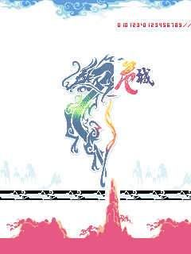 | **playable** | The country selection screen shows individual map markers, a transparent portrait overlay and the 确定 / 取消 softkeys. The tower-defence tutorial follows. |
| 巨作RPG曹操冢 (Mengde) |  | **playable** | Gameplay with the help dialog text readable (如当前武器为铲子时，可长按确定/5号键挖地) |
| 曹操冢超豪华版 (Mengde i) |  | **playable** | Gameplay; the help bar renders (按数字键3可以查看大地图显示) and the sprite pages load |
| 永恒魔塔 (yonghengmota) |  | **playable** | The music prompt and title artwork are centered. Dialogue and movement continue past the original trial deadline in the default offline configuration. |
| 胭脂戏游龙 (yzxyl) |  | **playable** | The opening story wraps across three lines. 西门庆居 shows the dialogue cue and movement tutorial inside their center panel. |
| 新星际撞球 (StarBall) | 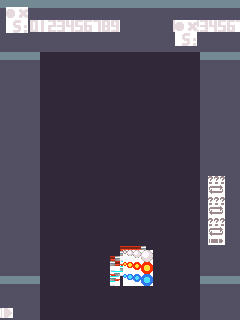 | **playable** | Arrow keys navigate the main menu and level selection. Losing the last ball offline replenishes the three paddles and resumes the round. |
| 新鬼吹灯 (Mengde pe) |  | **playable** | The title, intro, and cave render. Movement resumes after Continue and after the first NPC dialogue |
| 黄金矿工 (hjkg) |  | **playable** | M on the title screen or Options → Start Game opens the original New Game / Level Select menu. |
| 宇宙风暴 (yzfb) |  | **playable** | New Game opens the scrolling first level. Confirming the revive and acknowledging its result resumes the level. |

These ten titles arm the platform's `+0xAC` UI timer and use its
selector-10 re-entry to update the display.

### Startup and input checks

These screens show how far each package ran during capture. A title screen,
menu, or prompt records the observed result. Gameplay verification is
listed separately above. The initial input check uses six key presses at
frames 30, 60, 90, 120, 150 and 180, with keys 10, 10, 5, 5, 10 and 5.

| Title | Package prefix | Screenshot | Observed state |
|---|---|---|---|

| 09武侠巨作龙狼传 | `llz` |  | Resource prompt |
| 爆笑军旗-荣誉勋章 | `Armychess` | 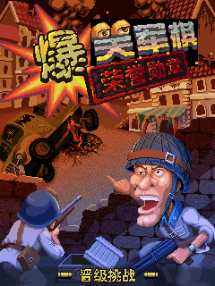 | Title |
| 病毒危机(新收费模式) | `VirusTD` | 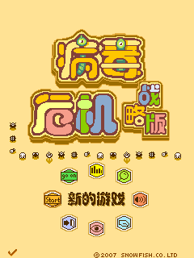 | Menu |
| 超级大富翁 | `cjdfw` | 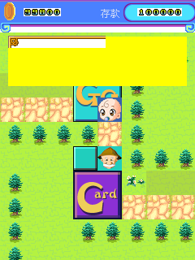 | **Board reached.** The scripted start sequence enters a new game and renders the board and player sprites. |
| 超级女生梦工场 | `cjns` | 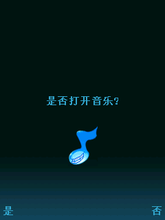 | Audio prompt |
| 虫蛊奇侠1 | `cgqx` | 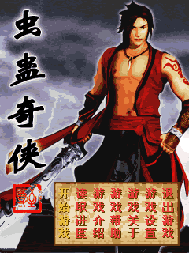 | Title |
| 虫蛊奇侠2 | `cgqx2` | 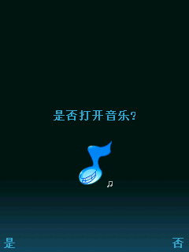 | Audio prompt |
| 打击者1945 | `djz1945` | 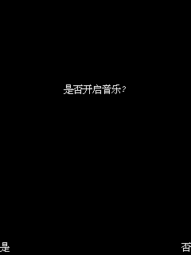 | Audio prompt |
| 地狱熔岩 | `diyurongyan` | 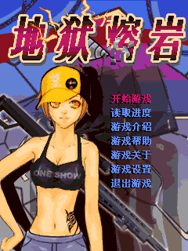 | Menu |
| 斗地主2009 | `newLander` | 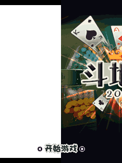 | Title |
| 斗地主3人 | `LanderPoker3` |  | Audio prompt |
| 夺宝奇兵 | `dbqb` | 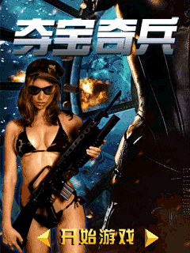 | Title |
| 俄罗斯方块 | `FangKuai` | 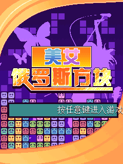 | Title |
| 反恐精英 | `cs` | 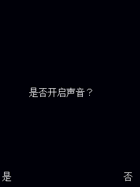 | Audio prompt |
| 公主台球2008 | `pool2008` | 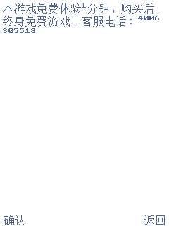 | Trial prompt |
| 观音求签 | `gyqq` |  | Audio prompt |
| 黑白棋 | `trunk2` |  | Trial prompt |
| 欢天喜地斗地主 | `htxdddz` | 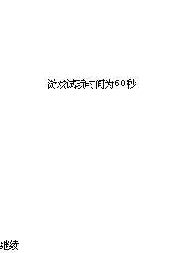 | Trial prompt |
| 角色幻想都市 | `sexycity` | 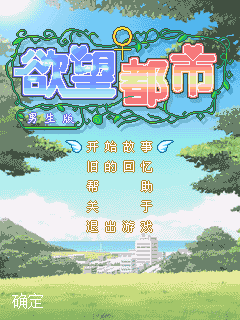 | Menu |
| 金庸群侠七书篇 | `jyqx` | 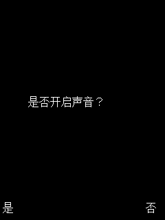 | Audio prompt |
| 劲乐派对 | `jypd` | 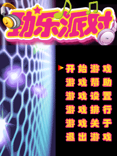 | Menu |
| 经典艺术百宝盒 | `Artist` | 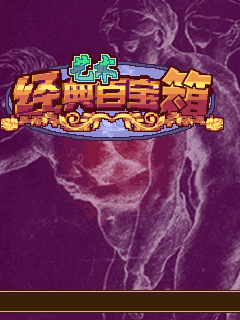 | Title |
| 经典音乐百宝盒 | `musician` | 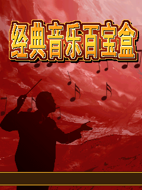 | Title |
| 绝代双娇 | `jdsj` | 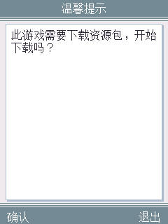 | Resource prompt |
| 狂刀伏魔录 | `kdfml` |  | Audio prompt |
| 雷电战机 | `ldzj` | 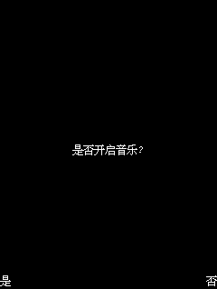 | Audio prompt |
| 灵翼战机2上 | `MagicWingIIEp1` | 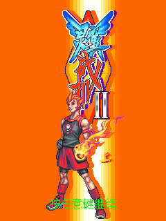 | Title |
| 灵翼战机2下 | `MagicWingIIEp2` | 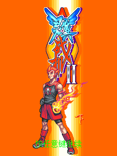 | Title |
| 灵翼战机II外传 | `MagicWings2L` | 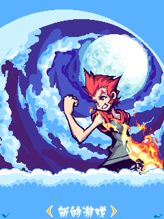 | Title |
| 乱世群英-三国麻将 | `SanguoMJ` | 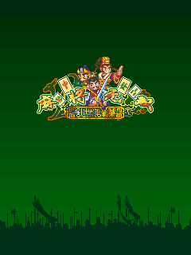 | Splash |
| 麻将天后 | `Majiang` | 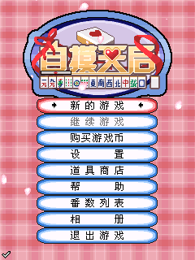 | Menu |
| 明星模仿秀-超级斗地主 | `ddz` |  | Save notice |
| 魔塔2(宝莲灯) | `mota2` | 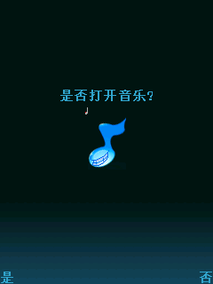 | Audio prompt |
| 南帝北丐双龙会 | `ndbgslh` |  | Resource prompt |
| 热舞旋风 | `dance` | 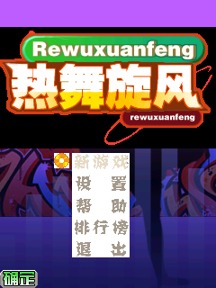 | **Menu.** The title and main menu render on startup. The left soft key opens difficulty selection. |
| 忍者传说 | `huoying` | 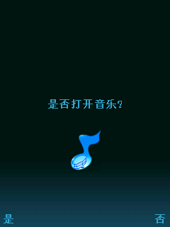 | Audio prompt |
| 三国赵云传 | `JLXJ` | 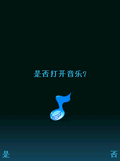 | Audio prompt |
| 射雕传奇 | `sdcq` |  | Resource prompt |
| 生化突袭 | `shtx` | 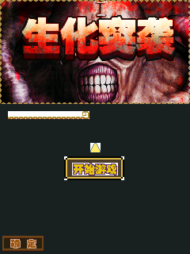 | Menu |
| 是男人就上100层 | `men` |  | Audio prompt |
| 暑期巨作完美情人 | `sexycity2` | 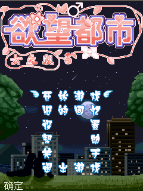 | Menu |
| 水浒秘史 | `shms` |  | Resource prompt |
| 水晶迷情 | `sjmq` | 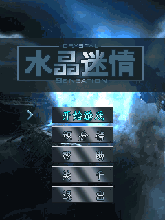 | Menu |
| 塔防之乱舞三国-危城无双续 | `sanguotd2` | 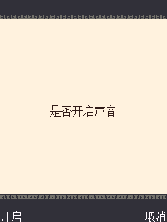 | Audio prompt |
| 天使方块 | `AngelCube` | 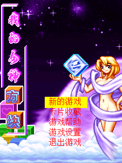 | Menu |
| 愚人大师 | `YRDS2` |  | Trial prompt |
| CS反恐特警 | `fktj` | 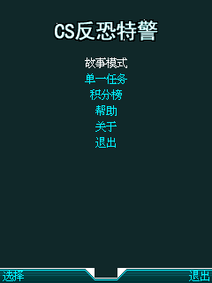 | Menu |

## Reaching the play state

The SDK's pay/session screens sit between the title and the game's own
menu in most titles. A scripted left-soft-key replay walks through them;
`--no-keys` disables the harness's automatic bring-up replay, which
presses OK every ten frames and can cycle a title back into the SDK
session page.

```sh
sfa_headless <game.app> --frames 200 --no-keys \
  --press 30:10 --press 60:10 --press 90:10 --press 120:10 --press 150:10 --press 180:10
```

That recipe (six left-soft-key presses over 200 frames) lands 五子棋 on
its board, 三国危城无双 on its splash/tutorial, both 曹操冢 builds and
永恒魔塔 in gameplay, and 胭脂戏游龙 in 西门庆居.

### 永恒魔塔

The game opens with a centered music prompt. Press the left soft key to
reach the title screen and see the full logo and centered Start Game
artwork. Capture the prompt after 26 frames or use the title replay.

```sh
sfa_headless <game.app> --frames 26 --no-keys
sfa_headless <game.app> --frames 55 --no-keys --press 30:10
```

When the original timed trial expires, the local SDK completion runs
the game's own registration callback and play continues. The
`offline_play_survives_the_trial_deadline` integration test verifies
registration and movement after expiry. Disabling either free-play
provisioning or the offline HTTP responder disables this local result.

### 胭脂戏游龙

Keep the companion resource container beside the application. With no
input, the game displays the 是否打开音乐？ prompt. The left and right
soft keys select Yes and No. Press OK at the title to read the opening
story, which wraps across three lines. Press OK again to enter 西门庆居
and see 与春梅对话。 Press OK once more for the movement tutorial.
The panel expands to fit all three tutorial lines.

```sh
sfa_headless <game.app> --frames 110 --no-keys \
  --press 30:10 --press 60:5 --press 90:5

sfa_headless <game.app> --frames 145 --no-keys \
  --press 30:10 --press 60:5 --press 90:5 --press 120:5
```

### StarBall (新星际撞球)

Use Up and Down to highlight a menu item and OK to open it. On the
level selection screen, Left and Right step by one level and Up and
Down step by four. The red outline marks the selected level.

OK serves each ball. After a miss, the next ball waits on the paddle.
This replay loses all three paddles, replenishes them through the
game's continue callback, and moves the paddle before serving again.

```sh
sfa_headless <game.app> --frames 247 --no-keys \
  --press 30:5 --press 60:5 --press 90:5 --press 120:5 --press 150:5 \
  --press 213:6 --press 240:5
```

### Three Kingdoms (三国危城无双)

The following replay reaches the country selection screen with Liu Bei
selected. Keep the companion resource container beside the application.

```sh
sfa_headless <game.app> --frames 455 --press 120:10 --press 300:10 \
  --press 350:10 --press 400:10 --press 450:10
```

To continue to the upgrade-mode selector, use `--frames 555` and add
`--press 500:10`. The option label is centered with a background sized
to its two CJK glyphs.

Set `SF_SANGUO_TD8_APP` to the package path and run
`cargo test -p snowfishemu-core --test sanguo_td8 -- --ignored` to verify
the softkeys, map markers, portrait transparency and upgrade-mode label.

### Gold Miner (黄金矿工)

Press **M** on the title screen to open the original New Game / Level
Select menu. **Z** opens Options, where Start Game reaches the same menu.
Press **Enter** on New Game to begin. RetroPad **L2** sends the Menu key.

```sh
sfa_headless <game.app> --frames 90 --press 30:11 --press 65:5 --press 82:5
```

Menu opens level selection. OK starts the first level and then
releases the claw. Set `SF_GOLD_MINER_APP` to the package path and run
`cargo test -p snowfishemu-core --test gold_miner -- --ignored` to verify
both start paths.

### Universe Storm (宇宙风暴)

Embedded music and bitmap blocks use the shared LZ decoder. If an
embedded stream is unreadable in guest memory, the decoder can retry
with a relocation-free range from the original package.

The left soft key (**Z**) accepts the music prompt. **Enter** opens the
main menu from the title and confirms **New Game**. The following replay
reaches the first level and steers the ship right.

```sh
sfa_headless <game.app> --frames 132 --press 30:10 --press 60:5 --press 98:5 --press 130:6
```

The recipe runs on the default launch settings (the provisioning answers
are on by default and this title tolerates them). The standalone frontend
keeps servicing window messages during static frames, including the
first-level loading screen.

After the last life, press **Z** on the revive question. The game shows
its own result notice. Press **Z** again to respawn in the current level.

```sh
sfa_headless <game.app> --frames 316 --no-keys \
  --press 30:10 --press 65:10 --press 98:5 --press 280:10 --press 296:10 --press 308:6
```

Set `SF_UNIVERSE_STORM_APP` to the package path and run
`cargo test -p snowfishemu-core --test universe_storm -- --ignored` to
verify the menu, ship controls, and first-level loading after an
overlapping SDK state write.

### 新鬼吹灯 (Mengde pe)

Press **X** at the title and **Z** to skip the intro. **M** opens the
pause menu. Choose Continue with **Enter** or **Z**.

Replay a pause, a quick confirmation, and a step to the right.

```sh
sfa_headless <game.app> --frames 124 --press 50:25 --press 65:10 \
  --press 96:11 --press 105:5 --press 114:6
```

Set `SF_GHOST_APP` to the package path and run
`cargo test -p snowfishemu-core --test ghost_menu -- --ignored` to verify
the menu layout, pause and resume, and movement after the first NPC
dialogue. Walk beside the NPC marked with a question mark and press
**Enter** to talk and advance each page. With the default offline settings,
the game completes its legacy service check when the final page closes.

## Known gaps

- **`__sfnetinfo__` is still refused**: the SDK reads that retry counter
  before posting; re-deriving its record layout would let the pay
  service skip the network round-trip entirely.
- **Label anchoring**: the bridge keeps the literal left-edge reading
  the reference uses and slides a label back inside the surface when it
  would overflow, so centre-anchored prompts (x = width/2) start at the
  centre column rather than being centred around it.

## Reproducing

The headless harness drives the same machine without a window:

```sh
sfa_headless <game.app> --frames 30 [--dump-fb <dir>] \
  [--no-free-play] [--no-offline-http] [--no-keys] [--keys 10] [--press frame:key]
```

Sibling resource containers are discovered next to the package
automatically (the rule is documented in
[Standalone Emulator](Standalone-Emulator.md#resource-files)), and a
download request naming a pack is answered with that pack's own bytes.
`--dump-fb` writes per-frame framebuffer dumps for offline
comparison (one 32-bit-per-pixel word per pixel). `--dump-mem
addr:len:path` (hex) exports a guest memory range, including the
framebuffer at `540720:25800` (raw RGB565).

### Debug environment variables

- `SF_4C="lr:val;*:val"` — override the +0x4C billing-capability result
  per call site (hex LRs; `*` sets the base, default 1)
- `SF_FREE_PLAY=0` — turn the registered-handset purchase answers off
  (they are on by default; `--no-free-play` does the same)
- `SF_OFFLINE_HTTP=0` — turn the local HTTP responder off
  (`--no-offline-http` does the same)
- `SF_NO_APP_PUMP=1` — suppress the per-frame selector-3 event
  (`sfa_headless --no-app-pump` does the same)
- `SF_SEED="addr:val;..."` — write guest words once after boot
- `SF_FORCE="addr:val;..."` — write guest words every frame
- `SF_VARS="addr,..."` — log guest words per frame around the tick
- `SF_PCTRACE="lo-hi"` — trace guest fetches inside an address range
- `SF_FSKIP="addr:val;..."` — function-entry skips (PC reaches `addr`
  → return with r0 = val); the SDK SMS send method uses this
- `SF_DCSMS="hex,hex,..."` — the encoded response record injected into
  the `__dcsmsinfo_` inbox
- `SF_DCSMS_LOOP=1` — re-arm the inbox injection on every empty open
- `SF_SENDINFO="hex,hex,..."` — the encoded send-record seeded into
  `__sfsmspaysendinfo_` (re-armed on every empty open); its first
  decoded dword (>0) is what makes the pay dispatch run the send
  driver
- `SF_IDENTITY="f1,f2,..."` — the plain subscriber-identity field
  list; the core XOR-0xF5-encodes it with the trailing checksum and
  installs the record callable. Experimental: also needs
  `SF_RECORD_LOOKUP=1`, because the SDK's record parse feeds plain
  text into its encoded-stream parsers
- `SF_TRACE` — log every platform slot and GDI operation
- `SF_FRAME_DUMP` (libretro test) — dump the core's presented frame
